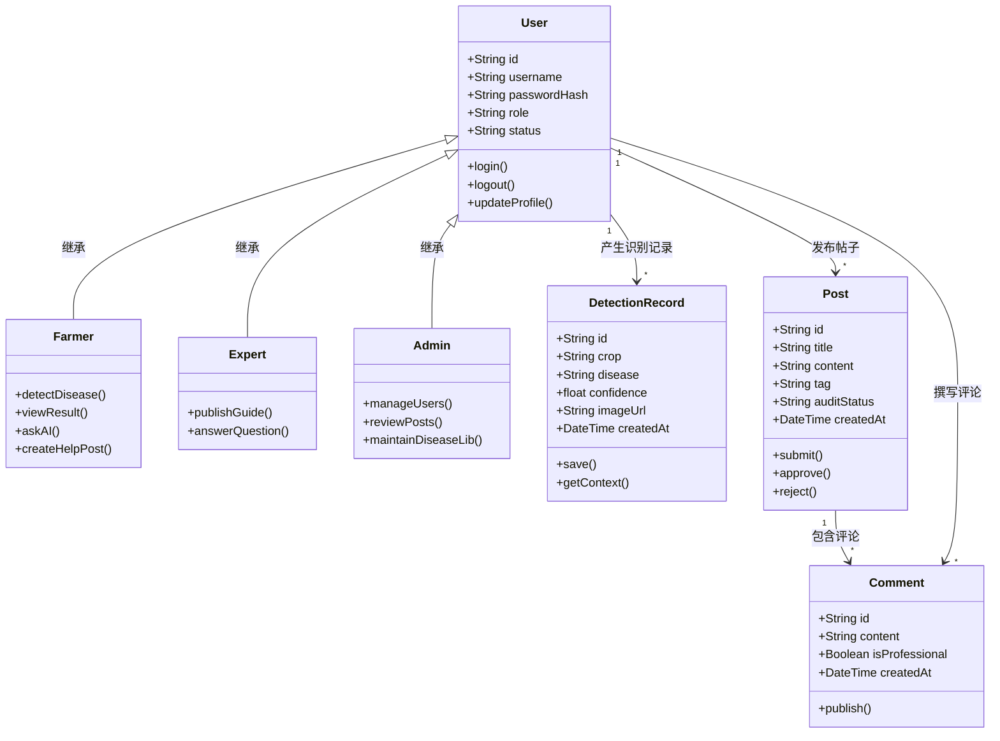
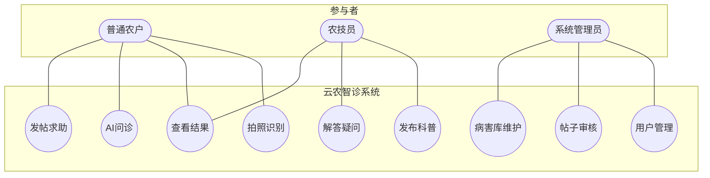
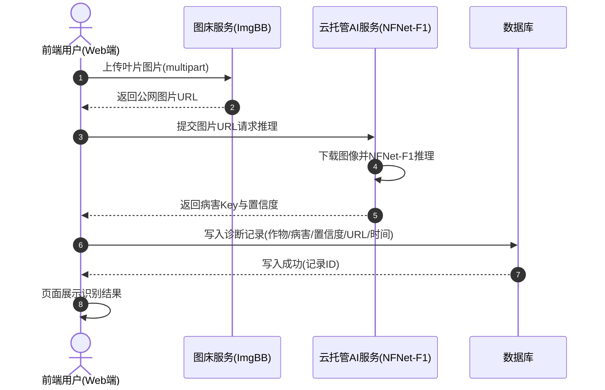
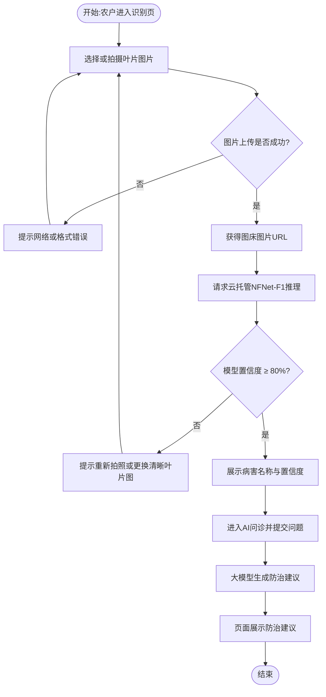
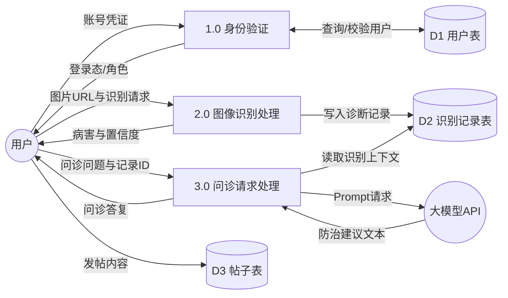
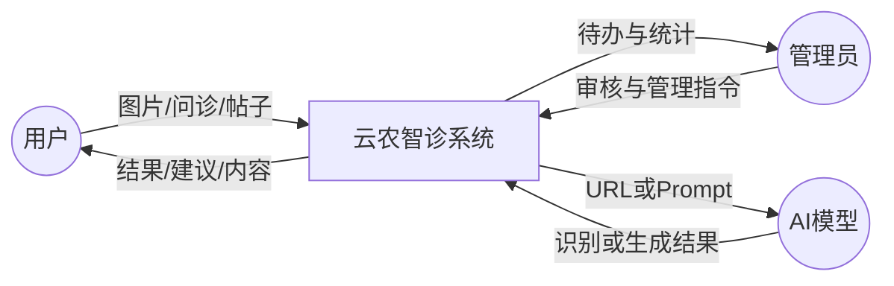

# 《云农智诊》全套软件工程图表（Mermaid）

> 使用说明：将每个 `mermaid` 代码块完整复制到 [https://mermaid.live](https://mermaid.live) 即可渲染。下列图均可直接粘贴进可行性分析、SA、OOA 与设计文档。

---

## 1. 面向对象（UML）类图（Class Diagram）

**文字解析**：本图描述《云农智诊》问题域的核心静态结构。`User` 通过继承特化为农户与农技员（管理员亦可特化），体现角色差异；用户与诊断记录、帖子为一对多关联，帖子与评论为一对多关联，与“一人多次识别、一帖多评”的业务事实一致。类上方法对应识别、问诊、发帖、审核等关键职责，便于映射到实现层实体与服务。

**如何查看此图**：打开 [Mermaid Live](https://mermaid.live)，粘贴上述代码；若中文注释显示异常，可去掉关联线上的中文标签仅保留多重度。

---

## 2. 用例图（Use Case Diagram）

**文字解析**：本图从外部参与者视角界定系统功能边界。普通农户聚焦拍照识别、结果查看、AI 问诊与发帖求助；农技员承担科普发布与答疑；管理员负责用户管理、帖子审核与病害库维护。三类用例集互不越权，支撑后续权限矩阵与接口鉴权设计。

**如何查看此图**：复制到 Mermaid Live 渲染。因 Mermaid 无原生 UML 椭圆用例语法，本图用圆形节点近似用例、圆角节点表示参与者，语义与标准用例图一致。

---

## 3. 核心业务时序图（Sequence Diagram）— 病虫害识别完整流程

**文字解析**：时序图刻画识别主路径上对象间的消息顺序：前端先将图片上传至图床并获得 URL，再以 URL 调用云托管 NFNet-F1，避免大文件直传与跨域问题；推理返回病害 Key 后写入数据库，最后由前端展示结果。该顺序与真实实现（图床 → 推理 → 落库 → 展示）完全一致。

**如何查看此图**：粘贴至 Mermaid Live；`autonumber` 便于在报告中按序号引用消息。若课程要求写“GitHub 图床”，可将参与者 `ImgBB` 改为 `GitHub/图床`，消息语义不变。

---

## 4. 业务活动图（Activity Diagram）— 农户获取防治建议

**文字解析**：活动图描述农户获取防治建议的完整控制流，包含“上传是否成功”与“置信度是否 ≥ 80%”两个判定分支。失败或低置信度均回流至重新拍照/上传，高置信度则展示结果并进入大模型问诊，最终输出防治建议，体现质量门禁与业务闭环。

**如何查看此图**：在 Mermaid Live 中打开；菱形为决策节点，可用于报告“正常流 / 异常流”说明。

---

## 5. 结构化数据流图（DFD 0 层）— 系统全局数据流转

**文字解析**：0 层 DFD 将系统分解为身份验证、图像识别处理、问诊请求处理等加工，外部实体为用户与大模型 API（识别侧亦可对接 NFNet 服务）。数据存储包括用户表、识别记录表与帖子表；数据流体现“鉴权读用户表、识别写记录表、问诊读记录并调大模型”的全局流转关系。

**如何查看此图**：复制到 Mermaid Live；圆角/圆形表示外部实体，矩形表示加工，圆柱表示数据存储。若需在图中显式画出 NFNet，可在 `P2` 右侧增加外部实体并连接“图片URL / 病害Key”数据流。

---

## 附：顶层 DFD（可选，报告补充）

**文字解析**：顶层图将整系统视为黑盒，仅展示用户、管理员、AI 模型与系统的输入输出，适合放在结构化分析报告开篇。

**如何查看此图**：同上，粘贴至 Mermaid Live 即可。
