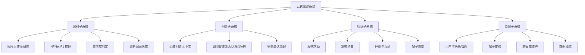
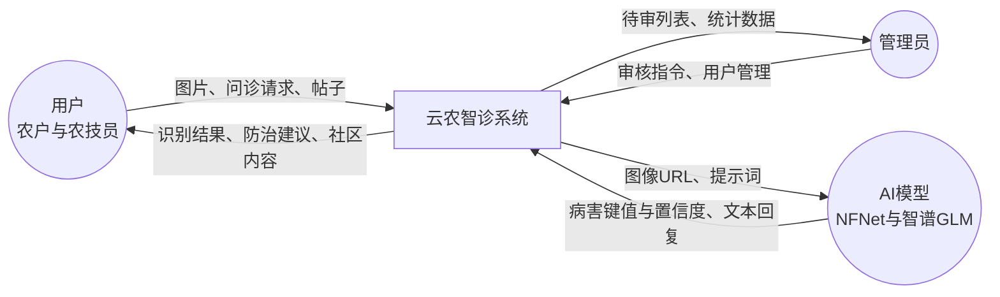
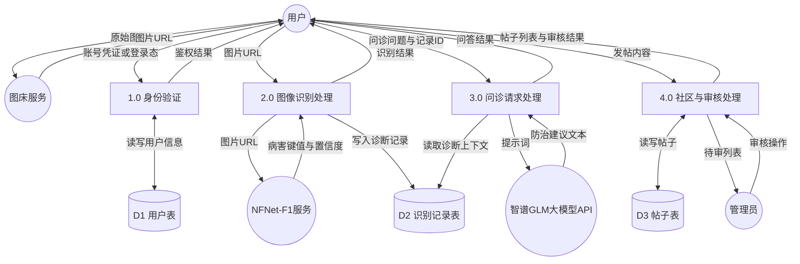

# 《云农智诊》结构化需求分析报告（SA）

## 1 文字分析

### 1.1 分析目的与方法

结构化需求分析（Structured Analysis）以“自顶向下、逐层分解、数据驱动”为基本思路，通过功能分解图、数据流图（DFD）与数据字典，清晰刻画系统做什么、数据从何处来、经何种加工、存于何处、又向何处去。本报告针对《云农智诊——基于 NFNet-F1 与大语言模型的农业智能问诊系统》，在可行性论证结论成立的前提下，从业务视角给出结构化需求描述，为后续面向对象分析、详细设计与测试用例编制提供依据。

### 1.2 系统目标与边界

《云农智诊》面向农作物病虫害诊断与基层农技服务场景，表现层采用 Vue3 构建 Web 页面。系统对外提供病虫害图像识别、基于智谱 GLM 大模型 API 的智能问诊、农技社区交流以及面向管理员的后台治理能力。其建设目标可概括为：帮助农户以较低门槛完成叶片病害初诊并获得可读的防治建议；支撑农技员发布科普、解答疑问；保障管理员对用户、帖子与病害资料的可控运营。

**系统边界内**主要包括：用户身份认证与角色鉴权；叶片图像上传编排与识别结果落库；诊断记录查询；问诊上下文组装与智谱 GLM 大模型 API 调用；社区发帖、评论及审核流转；病害库与基础内容维护；管理端数据概览等。上述能力由业务后端与云托管推理服务协同完成，属于本系统必须交付的范围。

**系统边界外**的外部实体包括：使用 Web 端的用户（含普通农户与农技员）、系统管理员、第三方图床服务、部署于云托管的 NFNet-F1 推理服务，以及智谱 GLM 大模型 API。图床仅负责图片公网分发；NFNet-F1 仅负责返回病害类别键值与置信度；智谱 GLM 大模型 API 仅负责根据提示词生成文本建议。三者均不纳入本系统内部数据存储与权限体系，通过明确的输入输出接口与系统交互。

划分边界的意义在于：避免将外部服务的内部实现误当作本系统功能进行建模，同时保证 DFD 中每一条跨越边界的数据流都有清晰的来源与去向，便于接口设计与联调验收。

### 1.3 功能分解说明

按结构化分析方法，将系统功能自上而下分解为四个相对独立、又通过数据相互衔接的子系统。各子系统职责如下。

**（1）识别子系统**  
负责将用户上传的叶片图像转化为可持久化的诊断结果。典型处理包括：把原始图片提交至图床并获取公网 URL；将 URL 交由云托管中的 NFNet-F1 完成推理；依据置信度阈值判定结果是否可信；把作物、病害、置信度、图片 URL 与时间等信息写入识别记录表，并支持历史查询。该子系统是问诊子系统的上游数据来源。

**（2）问诊子系统**  
在已有识别记录的基础上，面向用户自然语言问题提供防治建议。系统读取诊断上下文，组装提示词后调用智谱 GLM 大模型 API，将返回文本呈现于 Web 页面，并支持同一会话下的多轮追问。同时需处理超时、调用失败等异常，向用户给出可理解的提示，避免页面长时间无响应。

**（3）社区子系统**  
为农户与农技员提供经验交流与知识扩散通道。农户可发帖求助，农技员可发布科普并参与评论互动。帖子需进入审核流程后，方可对更广泛用户可见，从而与管理子系统形成衔接。

**（4）管理子系统**  
面向管理员提供运营与治理能力，包括用户与角色管理、帖子审核、病害库与内容维护，以及用户规模、待审数量、识别量等数据概览。该子系统不直接参与田间识别推理，但决定社区内容能否公开、账号是否可用，是系统安全与内容质量的保障环节。

四个子系统的功能一览如下：

| 子系统 | 主要功能 |
|--------|----------|
| 识别子系统 | 图片上传至图床、调用 NFNet-F1 推理、置信度判定、识别记录落库与查询 |
| 问诊子系统 | 基于识别上下文的多轮对话、调用智谱 GLM 大模型 API、超时与异常处理 |
| 社区子系统 | 发帖求助、科普发布、评论与互动、帖子浏览 |
| 管理子系统 | 用户与角色管理、帖子审核、病害库与内容维护、数据概览 |

### 1.4 数据流转说明（与业务一致）

结构化分析强调“数据在加工之间的流动”。结合本系统实际实现，主业务数据流转如下。

用户在 Web 端选择或拍摄叶片图片后，前端并不将大体积二进制图像直接作为推理请求体长时间占用连接，而是先将图片上传至图床。图床返回可公网访问的图片 URL。随后，Web 前端携带该 URL 请求云托管 AI 服务，由 NFNet-F1 完成下载与推理，返回病害类别键值与置信度。业务后端将诊断记录写入数据库，Web 前端向用户展示识别结果。

若用户继续发起智能问诊，系统将作物、病害、置信度等结构化字段与用户问题一并注入提示词，调用智谱 GLM 大模型 API，同步获得防治建议文本并展示。社区发帖则写入帖子表并进入待审状态，管理员审核通过后，帖子才对社区用户可见。

上述流转体现三个关键设计约束：其一，图片先经图床再以 URL 进入 AI，降低跨域与超时风险；其二，识别结果结构化落库，为问诊提供稳定上下文；其三，社区内容先审后发，保证公开信息可控。

---

## 2 功能分解图

**文字解析**：功能分解图从系统顶层出发，将《云农智诊》划分为识别子系统、问诊子系统、社区子系统与管理子系统，再向下展开至可独立开发与测试的叶子功能。该图体现结构化分析中的层次性与模块边界，有助于按子系统分配开发任务、编写测试用例，并与后文数据流图中的加工编号相互对照。识别与问诊通过诊断记录衔接，社区与管理通过帖子审核状态衔接，四者并非孤立清单，而是有数据依赖的功能树。

**如何查看**：复制上方代码至 [Mermaid Live Editor](https://mermaid.live) 即可渲染。

---

## 3 顶层数据流图（Context Diagram）

**文字解析**：顶层数据流图（也称上下文图）将整套《云农智诊》抽象为单一处理过程，目的是先明确系统与外部环境的接口，而不过早展开内部细节。图中，用户向系统提交图片、问诊请求与帖子内容，系统向用户返回识别结果、防治建议与社区可见内容；管理员下发审核指令与用户管理操作，系统向管理员反馈待审列表与统计数据；系统向 AI 侧发送图像 URL 或提示词，AI 侧返回病害键值与置信度或生成文本。顶层图用于约束后续 0 层分解：凡未在顶层出现的外部实体，一般不应突然出现在下层图中而无说明。

**如何查看**：粘贴至 Mermaid Live；圆形为外部实体，圆角矩形为系统处理。

---

## 4 0 层数据流图

**文字解析**：0 层数据流图在保持顶层外部实体的前提下，将系统内部细化为若干加工，并引入数据存储。本图设置身份验证、图像识别处理、问诊请求处理、社区与审核处理四类加工，以及用户表、识别记录表、帖子表三类核心数据存储；图床、NFNet-F1 服务与智谱 GLM 大模型 API 仍作为外部实体出现。

数据流向上需与真实业务一致：用户先将原始图片交给图床，获得图片 URL 后再进入图像识别处理；识别加工调用 NFNet-F1，把结果写入识别记录表并回传用户；问诊加工读取识别记录表中的上下文，向智谱 GLM 大模型 API 发送提示词，再将防治建议返回用户；发帖进入社区与审核处理，写入帖子表，管理员完成审核后，用户侧可见状态随之更新。该图是编制数据字典、接口清单与集成测试场景的重要依据。

**如何查看**：在 Mermaid Live 中打开；圆柱体表示数据存储，矩形表示加工过程。

---

## 5 数据字典（核心条目）

数据字典用于精确定义数据流、数据存储与加工的含义，消除图表标注中的歧义。以下列出本系统最核心的条目，足以支撑课设阶段的设计与测试；实施时可按表结构继续扩展字段级约束（长度、非空、唯一性等）。

### 5.1 数据流

| 名称 | 组成 | 说明 |
|------|------|------|
| 图片URL | 协议、主机、路径等构成的完整地址 | 图床返回的公网可访问地址，供推理服务拉取图像 |
| 识别结果 | 病害键值、置信度、作物等可选字段 | NFNet-F1 推理输出，亦是写入识别记录表的主要业务字段 |
| 问诊请求 | 用户ID、记录ID、问题文本、可选会话ID | 进入问诊加工，用于组装智谱 GLM 大模型提示词 |
| 审核指令 | 帖子ID、审核动作（通过、驳回或下架）、管理员ID | 管理子系统输入，驱动帖子状态变更 |
| 防治建议文本 | 由智谱 GLM 大模型 API 生成的自然语言段落 | 问诊加工的输出，展示于 Web 页面 |
| 鉴权结果 | 是否通过、角色信息、登录凭证等 | 身份验证加工的输出，决定后续接口可否访问 |

### 5.2 数据存储

**诊断记录（DetectionRecord）**  
保存每一次成功或需留痕的识别结果，是连接识别与问诊的核心存储。

| 数据项 | 类型与说明 |
|--------|------------|
| ID | 主键，唯一标识一条诊断记录 |
| 用户ID | 外键，关联用户表，标明发起识别的账号 |
| 作物 | 字符串，作物类型或名称 |
| 病害 | 字符串，病害名称或模型返回的类别键值 |
| 置信度 | 浮点数，取值范围一般为 0 到 1 |
| 图片URL | 字符串，指向图床上的叶片图像 |
| 时间 | 时间戳，记录识别完成或创建时刻 |

**用户表（User）**  
保存账号身份与权限相关信息，支撑登录鉴权与角色控制。

| 数据项 | 类型与说明 |
|--------|------------|
| ID | 主键 |
| 账号 | 唯一用户名，用于登录 |
| 角色 | 农户、农技员或管理员 |
| 状态 | 正常或禁用，禁用后不可登录或受限访问 |
| 密码摘要 | 哈希存储，禁止明文保存口令 |

**帖子表（Post）**  
保存社区内容及其审核状态，支撑发帖展示与管理审核。

| 数据项 | 类型与说明 |
|--------|------------|
| ID | 主键 |
| 作者ID | 外键，关联用户表 |
| 标题与正文 | 文本，帖子主要内容 |
| 标签 | 求助、科普等业务分类 |
| 审核状态 | 待审、通过、驳回或下架 |
| 创建时间 | 时间戳 |

### 5.3 加工说明

| 编号 | 名称 | 逻辑说明 |
|------|------|----------|
| 1.0 | 身份验证 | 校验用户提交的账号凭证或已有登录态，读写用户表，签发或刷新登录态，并向客户端返回鉴权结果；失败时拒绝进入受保护功能。 |
| 2.0 | 图像识别处理 | 接收图片 URL，调用 NFNet-F1 服务获取病害键值与置信度，必要时做置信度判定，将诊断记录写入识别记录表，并向用户返回识别结果。 |
| 3.0 | 问诊请求处理 | 根据记录ID读取识别上下文，与用户问题一并组装提示词，调用智谱 GLM 大模型 API，将防治建议文本返回 Web 端；对超时与失败进行提示处理。 |
| 4.0 | 社区与审核处理 | 接收用户发帖并写入帖子表（初始多为待审）；接收管理员审核操作并更新状态；向用户返回帖子列表与审核结果，向管理员返回待审列表。 |

### 5.4 小结

通过功能分解图明确“系统由哪些功能组成”，通过顶层与 0 层数据流图明确“数据如何在外部实体、加工与存储之间流动”，通过数据字典明确“每条数据与每个加工究竟指什么”。三者相互印证后，结构化需求即具备可设计、可实现、可测试的完整形态，可据此进入面向对象需求分析与系统设计阶段。
