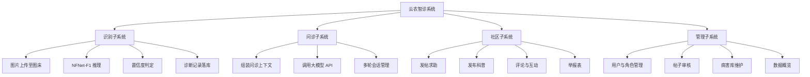
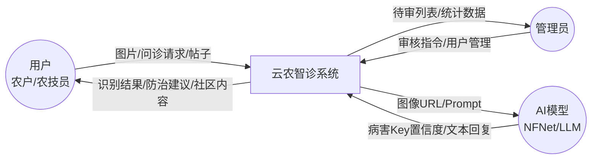
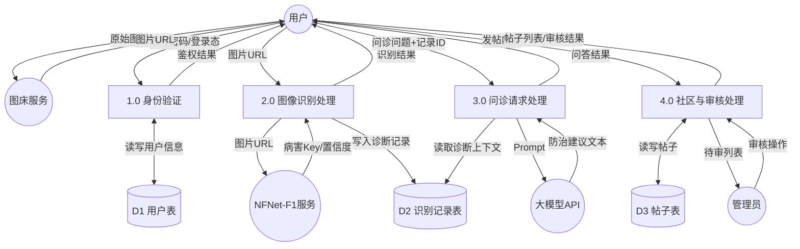

# 《云农智诊》结构化需求分析报告（SA）

## 1 文字分析

### 1.1 系统目标与边界

《云农智诊》面向农作物病虫害场景，对外提供图像识别、智能问诊、社区交流与后台管理能力。系统边界内包含：身份认证、图像上传与识别编排、诊断记录持久化、大模型问诊编排、社区发帖审核、病害库与用户管理。边界外实体包括：**用户（农户/农技员）**、**管理员**、**图床服务**、**NFNet-F1 推理服务**、**大模型 API**。

### 1.2 功能分解说明

按结构化分析方法，将系统功能自上而下分解为四个子系统：

| 子系统 | 主要功能 |
|--------|----------|
| 识别子系统 | 图片上传、调用推理、置信度判定、识别记录落库与查询 |
| 问诊子系统 | 基于识别上下文的多轮对话、超时与异常处理 |
| 社区子系统 | 发帖求助、科普发布、评论、收藏、举报表 |
| 管理子系统 | 用户与角色、帖子审核、病害库/内容维护、数据概览 |

### 1.3 数据流转（与业务一致）

1. 用户在前端选择叶片图片；  
2. 前端先将图片上传至 **图床**，获得公网 **URL**（避免将大文件直传推理服务造成超时与跨域问题）；  
3. 前端携带 URL（或服务端再拉取）请求 **云托管 AI**，NFNet-F1 返回病害 Key / 置信度；  
4. 业务后端将诊断记录写入数据库，前端展示结果；  
5. 问诊时将作物、病害、置信度等结构化字段注入 Prompt，调用大模型 API，流式或同步返回建议。

---

## 2 功能分解图

**文字解析**：本图将《云农智诊》自顶向下拆为识别、问诊、社区、管理四大子系统，体现结构化分析中的功能层次；各子系统再细化为可独立开发与测试的叶子功能，便于后续划分模块与用例。

**如何查看**：复制上方代码至 [Mermaid Live Editor](https://mermaid.live) 即可渲染。

---

## 3 顶层数据流图（Context Diagram）

**文字解析**：顶层 DFD 将系统视为单一处理过程，突出外部实体与系统的数据交换；用户提交图片与问诊请求，管理员下发审核与配置指令，AI 模型返回识别与生成结果，系统向各方回传业务响应。

**如何查看**：粘贴至 Mermaid Live；圆形为外部实体，圆角矩形为系统处理。

---

## 4 0 层数据流图

**文字解析**：0 层 DFD 细化身份验证、图像识别与问诊三类核心加工，并引入用户表、识别记录表、帖子表等数据存储；强调“图床 URL 进识别、结构化结果进问诊、审核状态进帖子表”的实际业务流向。

**如何查看**：在 Mermaid Live 中打开；圆柱体表示数据存储，矩形表示加工过程。

---

## 5 数据字典（核心条目）

### 5.1 数据流

| 名称 | 组成 | 说明 |
|------|------|------|
| 图片URL | 协议 + 主机 + 路径 | 图床返回的公网可访问地址 |
| 识别结果 | 病害Key + 置信度 + 作物可选字段 | NFNet 推理输出 |
| 问诊请求 | 用户ID + 记录ID + 问题文本 + 会话ID? | 进入 LLM 编排 |
| 审核指令 | 帖子ID + 动作(通过/驳回/下架) + 管理员ID | 管理子系统输入 |

### 5.2 数据存储

**诊断记录（DetectionRecord）**

| 数据项 | 类型/说明 |
|--------|-----------|
| ID | 主键 |
| 用户ID | 外键 → 用户表 |
| 作物 | 字符串 |
| 病害 | 病害名称/Key |
| 置信度 | 浮点数 0~1 |
| 图片URL | 字符串 |
| 时间 | 时间戳 |

**用户表（User）**

| 数据项 | 类型/说明 |
|--------|-----------|
| ID | 主键 |
| 账号 | 唯一用户名 |
| 角色 | FARMER / EXPERT / ADMIN |
| 状态 | 正常 / 禁用 |
| 密码摘要 | 哈希存储 |

**帖子表（Post）**

| 数据项 | 类型/说明 |
|--------|-----------|
| ID | 主键 |
| 作者ID | 外键 → 用户表 |
| 标题/正文 | 文本 |
| 标签 | 求助 / 科普等 |
| 审核状态 | 待审 / 通过 / 驳回 / 下架 |
| 创建时间 | 时间戳 |

### 5.3 加工简述

| 编号 | 名称 | 逻辑摘要 |
|------|------|----------|
| 1.0 | 身份验证 | 校验凭证，读写用户表，签发登录态 |
| 2.0 | 图像识别处理 | 接收 URL，调用 NFNet，写识别记录表 |
| 3.0 | 问诊请求处理 | 读识别上下文，调用大模型，返回建议 |
| 4.0 | 社区与审核处理 | 发帖入待审，管理员变更状态后对用户可见 |
