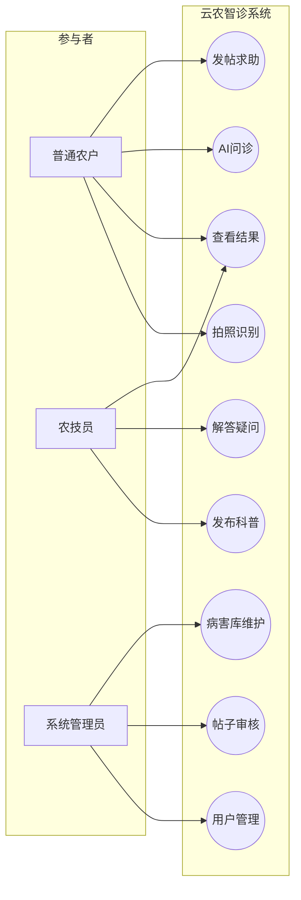
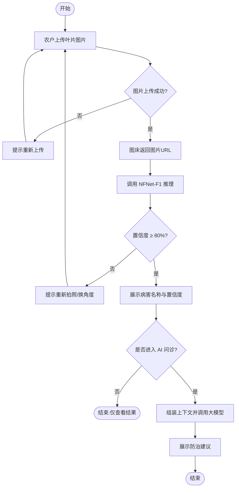
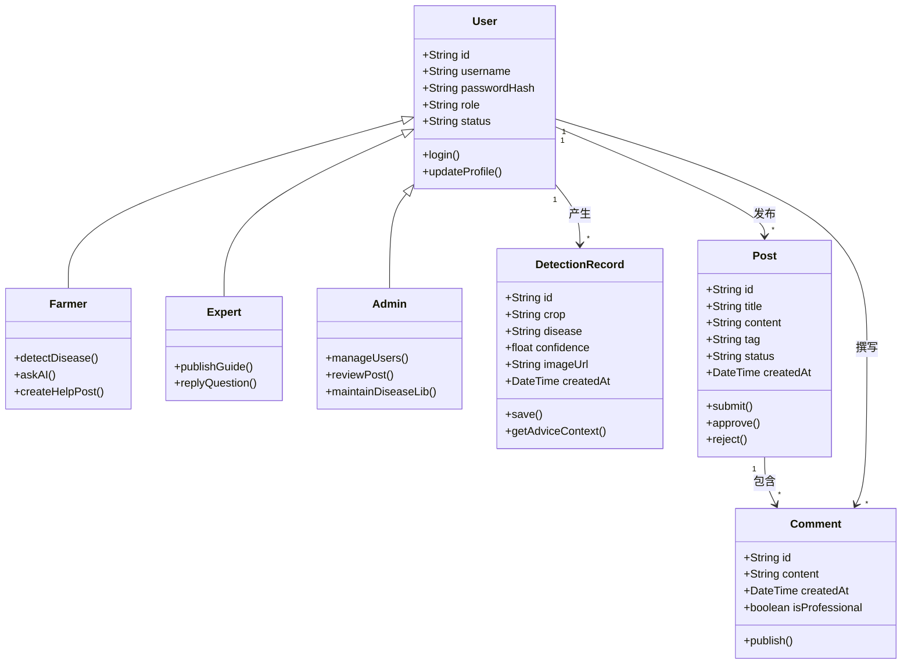

# 《云农智诊》面向对象需求分析报告（OOA）

## 1 文字分析

### 1.1 参与者与用例划分

从问题域识别三类主要参与者：**普通农户（Farmer）**、**农技员（Expert）**、**系统管理员（Admin）**。农户关注“拍照识别—查看结果—AI 问诊—发帖求助”闭环；农技员侧重“发布科普、解答疑问”；管理员负责“用户管理、帖子审核、病害库维护”。用例之间存在包含/扩展关系的潜力（如“查看结果”常包含在识别成功路径中），本报告以核心用例为主进行建模。

### 1.2 核心业务流程（活动视角）

“病虫害识别与智能问诊”活动以图片上传为起点：上传失败则提示重试；成功后调用推理；若置信度低于阈值（如 80%），提示重新拍照；否则展示结果并允许进入 AI 问诊，最终输出防治建议。该流程覆盖正常路径与异常/低置信度分支，适合作为验收的主场景。

### 1.3 领域类与关系

领域模型抽取四类核心实体：**User**、**DetectionRecord**、**Post**、**Comment**。通过特化体现农户/农技员/管理员继承自 User；User 与 Post、DetectionRecord 为一对多关联；Post 与 Comment 为一对多组合/关联。属性与方法聚焦业务行为（登录、识别、发帖、评论、审核），支撑后续类图到实现类的映射。

---

## 2 用例图（Use Case Diagram）

**文字解析**：本图从参与者视角刻画系统对外能力边界；农户用例覆盖识别与问诊主线，农技员补充知识供给，管理员保障运营秩序。三类角色通过不同用例集实现职责分离，与 RBAC 权限设计一致。

**如何查看**：复制到 [https://mermaid.live](https://mermaid.live) 渲染（以流程图近似表达 UML 用例图）。

---

## 3 核心活动图（病虫害识别与智能问诊）

**文字解析**：活动图描述农户从上传到获取防治建议的控制流，含上传成败与置信度阈值两个关键判定；低置信度回流至重新拍照，保证识别质量，高置信度路径进入问诊形成完整业务闭环。

**如何查看**：粘贴至 Mermaid Live；菱形为判定节点，圆角矩形为活动。

---

## 4 领域类图（Class Diagram）

**文字解析**：类图给出问题域静态结构：User 特化为三类角色；一名用户可产生多条诊断记录与多篇帖子；一篇帖子包含多条评论。方法反映用例驱动的职责分配，便于映射到实体层与服务层实现。

**如何查看**：在 Mermaid Live 中渲染；`<|--` 表示继承，`"1" --> "*"` 表示一对多关联。
