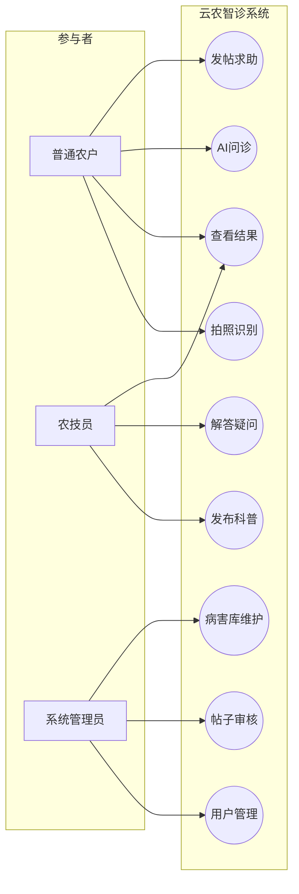
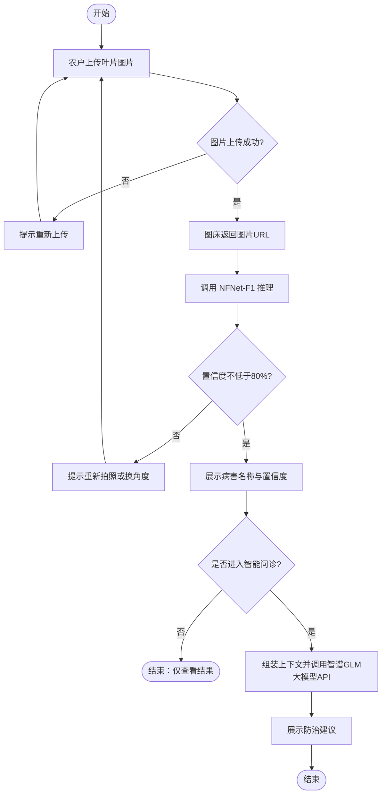
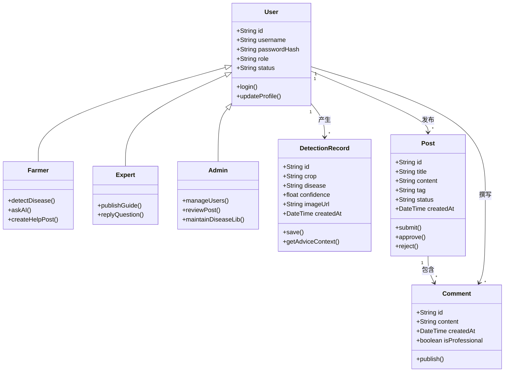

# 《云农智诊》面向对象需求分析报告（OOA）

## 1 文字分析

### 1.1 分析目的与方法

面向对象需求分析（Object-Oriented Analysis, OOA）从问题域出发，识别参与者与用例，梳理关键业务活动，并抽象出稳定的领域对象及其结构关系。与结构化分析侧重“数据如何流动”不同，面向对象分析更强调“谁对什么对象做了什么”，从而自然过渡到类图、时序图与后续实现中的实体类、控制类设计。

本报告针对《云农智诊》系统，在 Web 端（Vue3）业务范围内，围绕病虫害识别、智谱 GLM 大模型智能问诊、社区交流与后台管理等能力，给出用例视图、活动视图与领域类视图，为详细设计与编码实现提供对象层面的依据。

### 1.2 参与者与用例划分

从问题域识别三类主要参与者，其职责边界清晰，对应系统中的角色权限模型。

**普通农户（Farmer）**  
系统的主要服务对象。农户通过 Web 端完成拍照或选图识别、查看识别结果，并在需要时调用智谱 GLM 大模型 API 进行智能问诊；也可在社区中发帖求助，寻求农技员或其他用户的经验支持。农户不涉及后台审核与用户治理类操作。

**农技员（Expert）**  
经过认证的专业用户。农技员侧重发布科普内容、解答农户疑问，并可查看识别相关结果以增强答疑针对性。其用例体现“知识供给”职责，与农户的“求助与初诊”形成互补。

**系统管理员（Admin）**  
负责系统运营与内容治理。管理员执行用户管理、帖子审核与病害库维护等用例，保证账号安全、社区内容合规以及病害资料可维护，一般不直接参与田间识别与日常问诊操作。

三类参与者的核心用例划分如下：农户对应拍照识别、查看结果、AI 问诊、发帖求助；农技员对应发布科普、解答疑问；管理员对应用户管理、帖子审核、病害库维护。用例之间存在包含与扩展关系的潜力（例如“查看结果”常包含在识别成功路径中；问诊通常在已有有效识别记录之后发起）。本报告以核心用例为主进行建模，以保证课设文档重点突出、与实现范围一致。

### 1.3 核心业务流程（活动视角）

病虫害识别与智能问诊是贯穿验收的主场景，宜用活动图描述控制流与分支。流程以农户在 Web 端上传叶片图片为起点：若上传失败，系统提示重新上传；若上传成功，则由图床返回图片 URL，再调用云托管中的 NFNet-F1 完成推理。

推理完成后进入置信度判定：若置信度低于设定阈值（如百分之八十），系统提示重新拍照或更换拍摄角度，流程回流至上传环节，以避免低质量结果误导用户；若置信度达到阈值，则展示病害名称与置信度。此时用户可选择仅查看结果后结束，也可进入智能问诊：系统组装识别上下文与用户问题，调用智谱 GLM 大模型 API，最终展示防治建议。

该流程同时覆盖正常路径、上传失败路径与低置信度路径，能够直接映射为测试用例中的主成功场景与备选场景，适合作为课程设计验收的核心演示链路。

### 1.4 领域类与关系概览

在问题域中抽取四类核心实体类：**User（用户）**、**DetectionRecord（病害识别记录）**、**Post（社区帖子）**、**Comment（评论）**。为体现角色差异，将农户、农技员与管理员建模为 User 的特化子类，分别承载与角色相关的行为。

结构关系上：一名用户可产生多条诊断记录、发布多篇帖子、撰写多条评论；一篇帖子可包含多条评论。属性侧重标识、业务状态与关键业务字段，方法侧重用例驱动的职责（登录、识别、问诊、发帖、审核等），从而支撑后续从领域类图到实体层与服务层实现的映射。社区子系统范围限定为发帖、科普、评论与浏览等能力，不将收藏、举报等扩展功能纳入本领域模型的必选范围。

---

## 2 用例图（Use Case Diagram）

**文字解析**：用例图从外部参与者视角刻画《云农智诊》的功能边界。普通农户的用例构成“识别、查看、问诊、求助”主线；农技员的用例突出科普发布与疑问解答，并可查看结果以辅助专业回复；管理员的用例聚焦用户管理、帖子审核与病害库维护，保障系统可运营。三类角色通过不同用例集实现职责分离，与基于角色的访问控制（RBAC）设计一致，也便于后续为每个用例编制前置条件、基本流与异常流说明。

**如何查看**：复制到 [https://mermaid.live](https://mermaid.live) 渲染（以流程图近似表达 UML 用例图）。

---

## 3 核心活动图（病虫害识别与智能问诊）

**文字解析**：活动图描述农户从上传叶片图片到获取防治建议的完整控制流。图中包含两个关键判定：图片是否上传成功，以及模型置信度是否不低于百分之八十。上传失败或置信度不足时，流程回流并提示用户重新操作，体现质量门禁；置信度达标后展示识别结果，再由用户决定是否进入智谱 GLM 大模型问诊。该图将用例“拍照识别”“查看结果”“AI 问诊”串联为一条可执行业务路径，便于与时序图、测试场景交叉验证。

**如何查看**：粘贴至 Mermaid Live；菱形为判定节点，圆角矩形为活动。

---

## 4 领域类图（Class Diagram）

### 4.1 建模说明

领域类图给出问题域的静态结构视图，回答三个问题：系统中有哪些核心对象、对象具备哪些属性与行为、对象之间存在何种关系。本图以业务概念为中心进行抽象，不展开持久化框架注解、控制器或前端组件等实现细节，以便保持分析模型的稳定性。实现阶段可将 User、DetectionRecord、Post、Comment 映射为数据库实体或持久化对象，将各类业务方法落实到对应的应用服务中。

### 4.2 核心类说明

**User（用户）**  
所有登录主体的基类，封装账号身份的共性特征。属性包括用户标识、用户名、密码摘要、角色与账号状态等；方法包括登录、更新个人资料等。角色与状态字段支撑权限判定与启禁用控制，是关联诊断记录、帖子与评论的公共起点。

**Farmer（农户）**、**Expert（农技员）**、**Admin（管理员）**  
三者均特化自 User，分别表达不同角色在问题域中的行为差异。农户侧重病害识别、智能问诊与发帖求助；农技员侧重发布科普与回复疑问；管理员侧重用户管理、帖子审核与病害库维护。采用继承而非仅用角色枚举字段描述行为，有利于在分析阶段直观体现“不同参与者能做什么”；实现时可仍用单一用户表加角色字段落地，二者并不矛盾。

**DetectionRecord（病害识别记录）**  
记录一次识别的结果快照，是连接视觉推理与智能问诊的关键对象。属性涵盖作物、病害、置信度、图片 URL 与创建时间等；`save()` 表示落库，`getAdviceContext()` 表示向问诊过程提供结构化上下文。一名用户可对应多条识别记录，体现一对多关联。

**Post（社区帖子）**  
表示社区中的求助帖或科普帖等内容载体。属性包括标题、正文、标签、审核状态与创建时间等；`submit()` 表示用户提交发帖，`approve()` 与 `reject()` 对应管理员审核通过与驳回。一名用户可发布多篇帖子；一篇帖子可包含多条评论。

**Comment（评论）**  
表示用户对某篇帖子的回复内容。属性包括评论正文、创建时间以及是否专业评论等标记；`publish()` 表示发布评论。评论既从属于帖子（一对多），也由具体用户撰写（一对多），从而形成“用户—帖子—评论”的协作结构。

### 4.3 关系说明

1. **继承关系**：Farmer、Expert、Admin 继承自 User，共享身份属性，并扩展角色专属行为。  
2. **关联关系（一对多）**：User 与 DetectionRecord、User 与 Post、User 与 Comment、Post 与 Comment 均为一对多，分别对应“产生识别记录”“发布帖子”“撰写评论”“帖子包含评论”的业务事实。  
3. **与用例的对应**：类上方法并非任意罗列，而是由用例驱动。例如农户的 `detectDisease()`、`askAI()` 对应识别与问诊用例；管理员的 `reviewPost()` 对应帖子审核用例。这种对应关系有利于检查模型完整性，避免出现“有用例无对象职责”或“有方法无业务来源”的情况。

### 4.4 类图

**文字解析**：下图综合展示上述类、属性、方法与关系。阅读时可先看 User 及其三个子类，理解角色特化；再看 User 向外连出的诊断记录与帖子，理解用户产生的业务数据；最后看 Post 与 Comment 的包含关系，理解社区讨论的结构。该静态结构与前文用例图、活动图相互补充：用例说明“谁需要什么功能”，活动说明“功能如何按步骤执行”，类图说明“执行过程中持久存在哪些对象及其联系”。

**如何查看**：在 Mermaid Live 中渲染；`<|--` 表示继承，`"1" --> "*"` 表示一对多关联。

### 4.5 小结

面向对象需求分析通过参与者与用例界定系统对外服务，通过活动图刻画识别与问诊主路径的控制逻辑，通过领域类图固化问题域中的对象结构。三类视图共同构成从“需求是什么”到“对象如何组织”的桥梁。后续设计阶段可在本领域模型基础上补充边界类、控制类以及与图床、NFNet-F1、智谱 GLM 大模型 API 等外部系统的交互时序，完成向实现模型的过渡。
